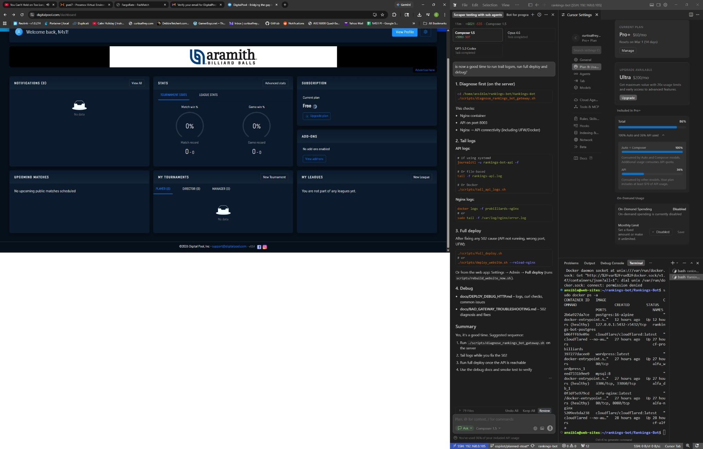
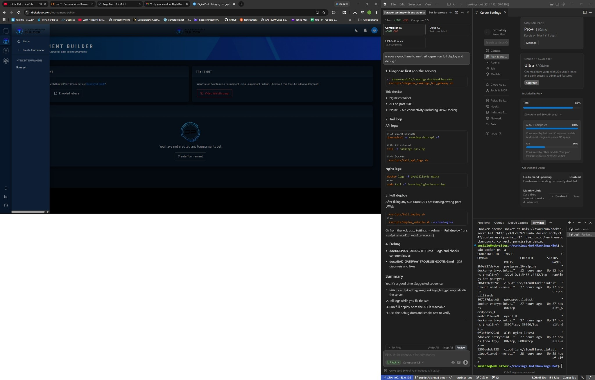
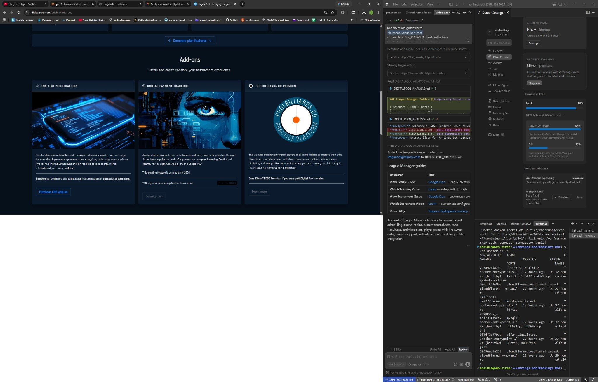

# External pool site — feature analysis & integration ideas

*(Public site URLs: [external pool vendor](https://digitalpool.com), this doc’s competitor reference.)*

**Analyzed:** February 5, 2026 (updated Feb 2026 with docs analysis)  
**Source:** [vendor homepage](https://digitalpool.com), [docs site](https://docs.digitalpool.com/), [leagues site](https://leagues.digitalpool.com/), tournament builder, videos  
**Purpose:** Extract ideas for Rankings Bot tournament management system

## Platform Overview

**External Pool** is a comprehensive billiards platform with:
- **Tournament Builder** - Tournament management software
- **League Manager** ([leagues site](https://leagues.digitalpool.com/)) - League operations
- **Tour Builder** - Multi-stop tour management
- **Player network** (external pool site) — social networking for players
- **Mobile Apps** - iOS & Android (14 languages)

---

## 📹 Video Resources for Analysis

Use these videos to understand External Pool's UX and workflows for improving the Rankings Bot:

| Resource | Link | Notes |
|----------|------|-------|
| **Tournament Builder (Video Walkthrough)** | [external pool vendor – tournament builder](https://digitalpool.com/tournament-builder) | Page includes a "Video Walkthrough" — primary reference for tournament setup flow |
| **Single Stage Tournament Setup** | [YouTube (5:20)](https://www.youtube.com/watch?v=jfngnn6xQow) | Comprehensive setup guide |
| **Tournament Builder: Self-reporting of Scores Demo** | [YouTube (@digitalpoolcom)](https://www.youtube.com/@digitalpoolcom/videos) | Score submission workflow |
| **Fargo Rate Handicapped Tournament Format** | [YouTube (@digitalpoolcom)](https://www.youtube.com/@digitalpoolcom/videos) | Handicap setup (1:32) |
| **Get Fargo Ratings for All Tournament Players** | [YouTube (@digitalpoolcom)](https://www.youtube.com/@digitalpoolcom/videos) | Fargo integration (0:53) |

**Quick Start docs:** [docs.digitalpool.com/tournament-builder-quick-start-guide](https://docs.digitalpool.com/tournament-builder-quick-start-guide)

### League Manager Guides ([leagues.digitalpool.com](https://leagues.digitalpool.com/))

| Resource | Link | Notes |
|----------|------|-------|
| **View Setup Guide** | [Google Doc](https://docs.google.com/document/d/1MxuvJpJ0IFW2sKpZBdlZOMOCAEwC6Ssv1CAOP3KXrqY/edit?usp=sharing) | League creation from start to finish |
| **Watch Training Video** | [Loom](https://loom.com/share/7dc03edeb8914ac2bca41f080dc4cecb) | Setup walkthrough |
| **View Scoresheet Guide** | [Google Doc](https://docs.google.com/document/d/1bOzYZig6D6wVVPgnmKqKZqfRIbvYJNMpF8t4WT7NsLg/edit?usp=sharing) | Customize scoresheets for league format |
| **Watch Scoresheet Video** | [Loom](https://www.loom.com/share/bdc5f7f136e148fdaaf6b8ab8f07b383) | Scoresheet configuration |
| **View FAQs** | [leagues.digitalpool.com/faqs](https://leagues.digitalpool.com/faqs) | League formats, player access, score entry |

**League Manager features to analyze:** Smart scheduling (round-robin), custom scoresheets, auto handicaps, real-time stats, player portal with live score entry, singles support, skill adjustments, Fargo-Rate integration.

**See also:** [docs/LEAGUE_MANAGER.md](docs/LEAGUE_MANAGER.md) for a dedicated League Manager reference.

---

## 📷 Reference Screenshots (Media)

Screenshots captured from External Pool for UX analysis. Stored in **`docs/screenshots/externalpool/`**.

| Folder | Count | Contents |
|--------|-------|----------|
| [docs/screenshots/externalpool/](docs/screenshots/externalpool/) | 49 images | Tournament Builder, Events, Pricing, League Manager, Videos, Stats, Pro Rankings, Player profile, Add-ons |

**Sample thumbnails:**

| Page | Screenshot |
|------|------------|
| Tour Builder |  |
| Tournament Type (Smart vs Free) |  |
| Settings (venue, format, Fargo) |  |
| Events |  |
| Pricing |  |
| League Manager |  |
| Add-ons (SMS, payments) |  |

See [docs/screenshots/externalpool/README.md](docs/screenshots/externalpool/README.md) for full index.

---

## 📚 Documentation Analysis (docs.digitalpool.com)

*Source: [docs.digitalpool.com](https://docs.digitalpool.com/) — February 2026*

### Workflow & UX Patterns

| Pattern | Their approach (external pool site) | Ideas for Rankings Bot |
|---------|---------------------|------------------------|
| **Minimal first step** | Complete only Step 1 to create tournament; remaining steps can be done later | Wizard with "Save draft" / partial completion; don't block on full config |
| **Private vs Public** | Toggle on Dashboard or Setup → Access; private = test/hidden until ready | Add visibility toggle; support "draft" tournaments |
| **Per-table scoring URLs** | Each table gets unique URL; no extra config; match assignment auto-updates tablet | `/tables/{table_id}/scoring` endpoints; WebSocket or polling for match assignment |
| **Player self-scoring** | Players submit scores from tablet/mobile; no account required | Guest scoring mode; QR code or short link per table |
| **TD approval flow** | Submit → Pending → TD approves → bracket advances, table released | `pending_matches` queue; "Approve Scores" action; visual indicator (blinking) for pending |
| **Events concept** | Group tournaments under one Event; tablets use event URL so no reconfig per tournament | `events` table; `/events/{slug}/tables/table-N/scoring` for multi-tournament venues |

### Live Scoring & Tablets

- **Tablet scoring:** Unique URL per table; when match assigned, names/race auto-appear; players tap +/- to score, then "Submit scores"
- **Casual Mode:** When no match assigned, show default screen; when match assigned, auto-switch to match view
- **TV display:** `/events/{event}/tables/table-N/tvdisplay` — OBS/streaming overlay; transparent background, scores auto-update
- **Rotating view:** `/events/{event}/tables` — all tables, rotates every 7 seconds
- **Tablet hardware:** 10.1" Android ~$55; Fully Kiosk ($10 lifetime) to prevent sleep; lowest brightness for 12+ hour runtime
- **Time savings (claimed):** 32 bracket ~2 hr, 64 bracket ~3 hr, 128 bracket ~4 hr

### Chip Tournament Format

- Each player starts with equal chips; lose one chip per loss
- Winner stays at table; loser goes to bottom of "Up next" queue
- Auto-pilot: next player from queue auto-assigned to open table (can disable)
- SMS when match assigned (if enabled) — includes opponent, table, live scoring link
- "Players eliminated" list; TD can add/remove chips per player

### Live Streaming Overlays

- Mark tables as "Live streaming table"; add stream link to bracket
- Overlay URL → OBS/Wirecast/vMix browser source; transparent, auto-updating scores
- "Overlays" dropdown in header for quick access

### Doc Structure (for our own docs)

- Quick Start (minimal path)
- Chip Tournament Guide (format-specific)
- Live Scoring Setup (tablets, automation)
- Live Streaming Overlays (OBS integration)

---

## 🎯 Key Features to Integrate

### 1. **Fargo Rate Integration** ⭐ HIGH PRIORITY

**What They Do:**
- Automatic Fargo Rating sync
- Pull official Fargo-Rates for players
- Fargo-based handicapping system
- Submit tournament results to Fargo Rate automatically
- Minimum Fargo Rate Robustness validation (e.g., 400 minimum)

**Ideas for Our System:**
```python
# New player fields to add
{
    "fargo_rating": 650,
    "fargo_robustness": 450,  # confidence level
    "fargo_last_sync": "2026-02-05",
    "fargo_auto_sync": true,
    "fargo_source": "official"  # official, estimated, manual
}

# Handicap calculator
def calculate_handicap(operator_fargo, player2_fargo, race_to=7):
    """
    Every 40 points difference in Fargo = -1 rack from lower player's race
    Maximum reductions: -3 racks on winners side, -2 racks on losers side
    680-740 Fargo: +1 rack
    741+: +2 racks
    """
    diff = abs(operator_fargo - player2_fargo)
    rack_adjustment = diff // 40
    
    # Cap adjustments
    rack_adjustment = min(rack_adjustment, 3)
    
    # Apply to lower-rated player
    if operator_fargo < player2_fargo:
        operator_race = max(race_to - rack_adjustment, 3)
        player2_race = race_to
    else:
        operator_race = race_to
        player2_race = max(race_to - rack_adjustment, 3)
    
    # High-rated player bonus
    if operator_fargo >= 741:
        operator_race += 2
    elif operator_fargo >= 680:
        operator_race += 1
    
    if player2_fargo >= 741:
        player2_race += 2
    elif player2_fargo >= 680:
        player2_race += 1
    
    return operator_race, player2_race
```

**Database Schema Addition:**
```sql
ALTER TABLE matches ADD COLUMN operator_handicapped_race INTEGER;
ALTER TABLE matches ADD COLUMN player2_handicapped_race INTEGER;
ALTER TABLE matches ADD COLUMN handicap_applied INTEGER DEFAULT 0;

CREATE TABLE fargo_sync_log (
    id INTEGER PRIMARY KEY AUTOINCREMENT,
    player_id TEXT NOT NULL,
    old_rating INTEGER,
    new_rating INTEGER,
    sync_date TIMESTAMP DEFAULT CURRENT_TIMESTAMP,
    sync_source TEXT,  -- 'api', 'manual', 'import'
    FOREIGN KEY (player_id) REFERENCES players(player_id)
);
```

**API Endpoints Needed:**
- `POST /api/tournaments/players/{player_id}/sync-fargo` - Manual Fargo sync
- `POST /api/tournaments/sync-all-fargo` - Bulk Fargo sync
- `GET /api/tournaments/matches/{match_id}/calculate-handicap` - Preview handicap
- `POST /api/tournaments/{tournament_id}/apply-fargo-handicaps` - Apply handicaps to all matches

---

### 2. **SMS Match Notifications** ⭐ HIGH PRIORITY

**What They Do:**
- Notify players via SMS when match is assigned to table
- Include: opponent name, start time, race, table number
- Real-time match call system

**Ideas for Our System:**
```python
# Notification service (Twilio, SNS, or similar)
class MatchNotificationService:
    def send_match_notification(self, match_id):
        match = get_match(match_id)
        
        message = f"""
Pool Tournament Alert:

Your match is up!
Opponent: {match.opponent_name}
Table: {match.table_number}
Race to: {match.race_to}
Time: {match.scheduled_time}

Good luck!
"""
        
        # Send SMS to both players
        send_sms(match.operator_phone, message)
        send_sms(match.player2_phone, message)
        
        # Log notification
        log_notification(match_id, 'sms', 'sent')
```

**Database Schema:**
```sql
CREATE TABLE notifications (
    id INTEGER PRIMARY KEY AUTOINCREMENT,
    player_id TEXT NOT NULL,
    match_id TEXT,
    notification_type TEXT,  -- 'sms', 'email', 'push'
    notification_status TEXT DEFAULT 'pending',  -- pending, sent, failed, read
    message TEXT,
    sent_at TIMESTAMP,
    read_at TIMESTAMP,
    created_at TIMESTAMP DEFAULT CURRENT_TIMESTAMP,
    FOREIGN KEY (player_id) REFERENCES players(player_id),
    FOREIGN KEY (match_id) REFERENCES matches(match_id)
);

-- Player notification preferences
ALTER TABLE players ADD COLUMN notification_sms INTEGER DEFAULT 1;
ALTER TABLE players ADD COLUMN notification_email INTEGER DEFAULT 1;
ALTER TABLE players ADD COLUMN notification_push INTEGER DEFAULT 1;
```

**API Endpoints:**
- `POST /api/tournaments/matches/{match_id}/notify` - Send match notification
- `POST /api/tournaments/{tournament_id}/notify-round/{round_number}` - Notify all players in round
- `GET /api/tournaments/players/{player_id}/notifications` - Get player notifications
- `PUT /api/tournaments/notifications/{notification_id}/read` - Mark as read

---

### 3. **Projected Match Times** ⭐ MEDIUM PRIORITY

**What They Do:**
- Software predicts when next matches will start
- Based on tournament progression and average match duration
- Helps players know when to arrive

**Ideas for Our System:**
```python
def calculate_projected_times(tournament_id, avg_match_duration_mins=45):
    """
    Calculate projected start times for all pending matches
    """
    matches = get_tournament_matches(tournament_id)
    completed_matches = [m for m in matches if m['status'] == 'completed']
    
    # Calculate actual average from completed matches
    if completed_matches:
        total_duration = sum([
            (m['completed_at'] - m['started_at']).total_seconds() / 60
            for m in completed_matches if m['started_at'] and m['completed_at']
        ])
        avg_match_duration_mins = total_duration / len(completed_matches)
    
    # Project times for pending matches
    current_time = datetime.now()
    for round_num in sorted(set(m['round_number'] for m in matches)):
        round_matches = [m for m in matches if m['round_number'] == round_num]
        
        # For pending matches, project based on previous round completion
        pending = [m for m in round_matches if m['status'] == 'pending']
        if pending:
            # Assume previous round finishes first
            prev_round_completion = max([
                m['completed_at'] for m in matches 
                if m['round_number'] == round_num - 1 and m['completed_at']
            ], default=current_time)
            
            for match in pending:
                match['projected_start'] = prev_round_completion
                match['projected_end'] = prev_round_completion + timedelta(minutes=avg_match_duration_mins)
```

**Database Schema:**
```sql
ALTER TABLE tournaments ADD COLUMN avg_match_duration_mins REAL DEFAULT 45.0;
ALTER TABLE matches ADD COLUMN projected_start_time TIMESTAMP;
ALTER TABLE matches ADD COLUMN projected_end_time TIMESTAMP;

-- Tournament timing settings
CREATE TABLE tournament_timing (
    id INTEGER PRIMARY KEY AUTOINCREMENT,
    tournament_id TEXT NOT NULL,
    tables_available INTEGER DEFAULT 8,
    concurrent_matches_max INTEGER DEFAULT 8,
    avg_match_duration REAL DEFAULT 45.0,
    break_between_rounds REAL DEFAULT 15.0,
    updated_at TIMESTAMP DEFAULT CURRENT_TIMESTAMP,
    FOREIGN KEY (tournament_id) REFERENCES tournaments(tournament_id)
);
```

---

### 4. **Live Scoring & Real-time Bracket Updates** ⭐ HIGH PRIORITY

**What They Do:**
- Players and spectators access live brackets on mobile devices
- "Say goodbye to people hovering around the tournament board"
- Real-time statistics updates
- Live tournament progress percentage

**Ideas for Our System:**
```javascript
// WebSocket implementation for real-time updates
class TournamentStreamService {
    constructor(tournament_id) {
        this.ws = new WebSocket(`wss://api.example.com/ws/tournaments/${tournament_id}`);
        
        this.ws.onmessage = (event) => {
            const data = JSON.parse(event.data);
            
            switch(data.type) {
                case 'match_score_update':
                    this.updateMatchScore(data.match_id, data.scores);
                    break;
                case 'match_completed':
                    this.handleMatchComplete(data.match_id, data.winner_id);
                    break;
                case 'player_advanced':
                    this.updateBracket(data.from_match, data.to_match, data.player_id);
                    break;
                case 'tournament_progress':
                    this.updateProgress(data.percentage);
                    break;
            }
        };
    }
    
    broadcastScoreUpdate(match_id, operator_score, player2_score) {
        this.ws.send(JSON.stringify({
            type: 'match_score_update',
            match_id: match_id,
            scores: {
                operator: operator_score,
                player2: player2_score
            }
        }));
    }
}
```

**API Endpoints:**
- `GET /api/tournaments/{tournament_id}/stream` - WebSocket endpoint
- `GET /api/tournaments/{tournament_id}/bracket/live` - Real-time bracket state
- `GET /api/tournaments/{tournament_id}/progress` - Tournament completion percentage

---

### 5. **Online Registration & Payment** ⭐ MEDIUM PRIORITY

**What They Do:**
- Players register and pay entry fees online
- Waiting lists and RSVP support
- Early bird discounts (e.g., $100 if register 2+ weeks early, $125 regular)
- Player limit caps (e.g., max 24 players)

**Ideas for Our System:**
```python
# Tournament registration settings
class TournamentRegistration:
    tournament_id: str
    entry_fee: float
    early_bird_fee: float
    early_bird_deadline: date
    max_players: int
    current_players: int
    waitlist_enabled: bool
    payment_required: bool
    payment_methods: List[str]  # ['stripe', 'paypal', 'cash']
    
def register_player_with_payment(tournament_id, player_id):
    tournament = get_tournament(tournament_id)
    
    # Check capacity
    if tournament.current_players >= tournament.max_players:
        if tournament.waitlist_enabled:
            add_to_waitlist(tournament_id, player_id)
            return {"status": "waitlisted", "position": get_waitlist_position(tournament_id, player_id)}
        else:
            raise Exception("Tournament is full")
    
    # Calculate fee
    today = date.today()
    if today <= tournament.early_bird_deadline:
        fee = tournament.early_bird_fee
        discount = tournament.entry_fee - tournament.early_bird_fee
    else:
        fee = tournament.entry_fee
        discount = 0
    
    # Process payment
    if tournament.payment_required:
        payment = process_payment(player_id, fee, f"Entry: {tournament.tournament_name}")
        if not payment.success:
            raise Exception("Payment failed")
    
    # Register player
    register_player(tournament_id, player_id)
    
    return {
        "status": "registered",
        "fee_paid": fee,
        "discount": discount,
        "payment_id": payment.id if tournament.payment_required else None
    }
```

**Database Schema:**
```sql
CREATE TABLE tournament_registration_settings (
    id INTEGER PRIMARY KEY AUTOINCREMENT,
    tournament_id TEXT NOT NULL UNIQUE,
    entry_fee REAL NOT NULL,
    early_bird_fee REAL,
    early_bird_deadline DATE,
    max_players INTEGER,
    waitlist_enabled INTEGER DEFAULT 1,
    payment_required INTEGER DEFAULT 0,
    payment_methods TEXT,  -- JSON array
    refund_policy TEXT,
    created_at TIMESTAMP DEFAULT CURRENT_TIMESTAMP,
    FOREIGN KEY (tournament_id) REFERENCES tournaments(tournament_id)
);

CREATE TABLE tournament_payments (
    id INTEGER PRIMARY KEY AUTOINCREMENT,
    tournament_id TEXT NOT NULL,
    player_id TEXT NOT NULL,
    amount REAL NOT NULL,
    payment_method TEXT,
    payment_status TEXT DEFAULT 'pending',  -- pending, completed, refunded, failed
    payment_gateway_id TEXT,  -- Stripe charge ID, etc.
    paid_at TIMESTAMP,
    refunded_at TIMESTAMP,
    created_at TIMESTAMP DEFAULT CURRENT_TIMESTAMP,
    FOREIGN KEY (tournament_id) REFERENCES tournaments(tournament_id),
    FOREIGN KEY (player_id) REFERENCES players(player_id)
);

CREATE TABLE tournament_waitlist (
    id INTEGER PRIMARY KEY AUTOINCREMENT,
    tournament_id TEXT NOT NULL,
    player_id TEXT NOT NULL,
    position INTEGER,
    status TEXT DEFAULT 'waiting',  -- waiting, promoted, cancelled
    added_at TIMESTAMP DEFAULT CURRENT_TIMESTAMP,
    promoted_at TIMESTAMP,
    FOREIGN KEY (tournament_id) REFERENCES tournaments(tournament_id),
    FOREIGN KEY (player_id) REFERENCES players(player_id),
    UNIQUE(tournament_id, player_id)
);
```

---

### 6. **Tournament Format Variety** ⭐ LOW PRIORITY (Future)

**Formats They Support:**
- Single Elimination ✅ (Already implemented)
- Double Elimination ⚠️ (Partially implemented)
- Group Stage / Round Robin
- Fargo Hot Column
- Chip Tournaments
- Ghost Events
- Scotch Doubles (Team format)

**Ideas for Our System:**
```python
# Extend elimination_type enum
class TournamentFormat(str, Enum):
    SINGLE_ELIMINATION = "single"
    DOUBLE_ELIMINATION = "double"
    ROUND_ROBIN = "round_robin"
    GROUP_STAGE = "group_stage"
    SWISS_SYSTEM = "swiss"
    FARGO_HOT_COLUMN = "fargo_hot_column"
    CHIP_TOURNAMENT = "chip"
    GHOST_EVENT = "ghost"
    SCOTCH_DOUBLES = "scotch_doubles"

# Round robin generator
def generate_round_robin_bracket(tournament_id):
    """
    Round robin: Each player plays every other player once
    """
    players = get_tournament_players(tournament_id)
    n = len(players)
    
    # Generate all possible pairings
    matches = []
    round_num = 1
    match_num = 1
    
    for i in range(n):
        for j in range(i+1, n):
            match_id = f"{tournament_id}-RR{round_num}-M{match_num}"
            matches.append({
                "match_id": match_id,
                "tournament_id": tournament_id,
                "round_number": round_num,
                "match_number": match_num,
                "operator_id": players[i]['player_id'],
                "player2_id": players[j]['player_id'],
                "bracket_type": "round_robin"
            })
            match_num += 1
    
    return matches
```

---

### 7. **Quick Templates & Tournament Builder** ⭐ HIGH PRIORITY

**What They Do:**
- Save complex tournament formats as quick templates
- One-click tournament creation from templates
- Templates include: format, races, handicaps, rules

**Already Implemented:**
✅ Tournament templates table exists
✅ Template creation/retrieval API endpoints
✅ Points structure templates

**Enhancements Needed:**
```sql
-- Extend tournament templates with more settings
ALTER TABLE tournament_templates ADD COLUMN fargo_handicap_enabled INTEGER DEFAULT 0;
ALTER TABLE tournament_templates ADD COLUMN early_bird_fee REAL;
ALTER TABLE tournament_templates ADD COLUMN entry_fee REAL;
ALTER TABLE tournament_templates ADD COLUMN race_to_winners INTEGER DEFAULT 7;
ALTER TABLE tournament_templates ADD COLUMN race_to_losers INTEGER DEFAULT 6;
ALTER TABLE tournament_templates ADD COLUMN race_to_finals INTEGER DEFAULT 9;
ALTER TABLE tournament_templates ADD COLUMN rules_text TEXT;
ALTER TABLE tournament_templates ADD COLUMN game_type TEXT;  -- '8-ball', '9-ball', '10-ball', 'one-pocket'
```

**API Enhancement:**
```python
@router.post("/tournaments/from-template/{template_id}")
async def create_tournament_from_template(
    template_id: int,
    tournament_name: str,
    tournament_date: date,
    location: str
):
    """
    Create new tournament from saved template
    Copies all settings: format, points, races, handicaps, etc.
    """
    template = get_template(template_id)
    
    tournament_data = {
        "tournament_name": tournament_name,
        "tournament_date": tournament_date,
        "location": location,
        "elimination_type": template.elimination_type,
        "max_players": template.max_players,
        "points_structure": template.points_structure,
        "template_id": template_id,
        # Copy additional settings from extended template
        "race_to": template.race_to_winners,
        "rules": template.rules_text,
        "game_type": template.game_type
    }
    
    tournament_id = create_tournament(tournament_data)
    return {"tournament_id": tournament_id, "template_used": template.template_name}
```

---

### 8. **Tour & Series Support** ⭐ LOW PRIORITY (Future)

**What They Do:**
- Manage multi-stop tours with ease
- Instant access to past results or qualifications
- Series points across multiple tournaments
- Cumulative standings

**Ideas for Our System:**
```sql
CREATE TABLE tours (
    id INTEGER PRIMARY KEY AUTOINCREMENT,
    tour_id TEXT UNIQUE NOT NULL,
    tour_name TEXT NOT NULL,
    series_year INTEGER,
    start_date DATE,
    end_date DATE,
    points_system TEXT,  -- JSON: how to accumulate points
    status TEXT DEFAULT 'active',
    created_by TEXT,
    created_at TIMESTAMP DEFAULT CURRENT_TIMESTAMP
);

CREATE TABLE tour_stops (
    id INTEGER PRIMARY KEY AUTOINCREMENT,
    tour_id TEXT NOT NULL,
    tournament_id TEXT NOT NULL,
    stop_number INTEGER,
    is_finals INTEGER DEFAULT 0,
    multiplier REAL DEFAULT 1.0,  -- Points multiplier for this stop
    FOREIGN KEY (tour_id) REFERENCES tours(tour_id),
    FOREIGN KEY (tournament_id) REFERENCES tournaments(tournament_id)
);

CREATE TABLE tour_standings (
    id INTEGER PRIMARY KEY AUTOINCREMENT,
    tour_id TEXT NOT NULL,
    player_id TEXT NOT NULL,
    total_points REAL DEFAULT 0,
    stops_played INTEGER DEFAULT 0,
    tour_rank INTEGER,
    best_finish INTEGER,
    updated_at TIMESTAMP DEFAULT CURRENT_TIMESTAMP,
    FOREIGN KEY (tour_id) REFERENCES tours(tour_id),
    FOREIGN KEY (player_id) REFERENCES players(player_id),
    UNIQUE(tour_id, player_id)
);
```

---

### 9. **League Management Integration** ⭐ MEDIUM PRIORITY

**From external pool leagues (vendor site):**

**Key Features:**
- Smart scheduling (round-robin auto-generation)
- Custom scoresheets per league
- Auto handicaps based on player averages
- Skill level adjustments
- Player portal with score entry
- Team standings and statistics

**Ideas for Our System:**
```sql
-- Add league support (future enhancement)
CREATE TABLE leagues (
    id INTEGER PRIMARY KEY AUTOINCREMENT,
    league_id TEXT UNIQUE NOT NULL,
    league_name TEXT NOT NULL,
    season_name TEXT,
    format TEXT,  -- 'team', 'singles', 'scotch_doubles'
    schedule_type TEXT,  -- 'round_robin', 'manual'
    handicap_system TEXT,  -- 'apa', 'fargo', 'custom'
    created_at TIMESTAMP DEFAULT CURRENT_TIMESTAMP
);

CREATE TABLE league_teams (
    id INTEGER PRIMARY KEY AUTOINCREMENT,
    league_id TEXT NOT NULL,
    team_name TEXT NOT NULL,
    home_venue TEXT,
    captain_player_id TEXT,
    wins INTEGER DEFAULT 0,
    losses INTEGER DEFAULT 0,
    FOREIGN KEY (league_id) REFERENCES leagues(league_id),
    FOREIGN KEY (captain_player_id) REFERENCES players(player_id)
);

CREATE TABLE league_matches (
    id INTEGER PRIMARY KEY AUTOINCREMENT,
    league_id TEXT NOT NULL,
    week_number INTEGER,
    home_team_id INTEGER,
    away_team_id INTEGER,
    home_score INTEGER DEFAULT 0,
    away_score INTEGER DEFAULT 0,
    match_date DATE,
    FOREIGN KEY (league_id) REFERENCES leagues(league_id),
    FOREIGN KEY (home_team_id) REFERENCES league_teams(id),
    FOREIGN KEY (away_team_id) REFERENCES league_teams(id)
);
```

---

### 10. **Player Statistics & Social Features** ⭐ MEDIUM PRIORITY

**What They Do:**
- Player news feeds
- Social networking (friends, followers)
- Player profiles with photos
- Real-time chat
- Performance tracking over time
- RSVP for tournaments
- Player activity feeds

**Already Implemented:**
✅ Player statistics table
✅ Basic player profiles
✅ Tournament history tracking

**Enhancements Needed:**
```sql
-- Social features
CREATE TABLE player_connections (
    id INTEGER PRIMARY KEY AUTOINCREMENT,
    player_id TEXT NOT NULL,
    connected_player_id TEXT NOT NULL,
    connection_type TEXT,  -- 'friend', 'follower', 'blocked'
    created_at TIMESTAMP DEFAULT CURRENT_TIMESTAMP,
    FOREIGN KEY (player_id) REFERENCES players(player_id),
    FOREIGN KEY (connected_player_id) REFERENCES players(player_id),
    UNIQUE(player_id, connected_player_id, connection_type)
);

CREATE TABLE player_activity_feed (
    id INTEGER PRIMARY KEY AUTOINCREMENT,
    player_id TEXT NOT NULL,
    activity_type TEXT,  -- 'tournament_win', 'rank_change', 'match_complete', 'profile_update'
    activity_data TEXT,  -- JSON
    created_at TIMESTAMP DEFAULT CURRENT_TIMESTAMP,
    FOREIGN KEY (player_id) REFERENCES players(player_id)
);

CREATE TABLE tournament_rsvp (
    id INTEGER PRIMARY KEY AUTOINCREMENT,
    tournament_id TEXT NOT NULL,
    player_id TEXT NOT NULL,
    rsvp_status TEXT DEFAULT 'interested',  -- 'interested', 'going', 'not_going'
    created_at TIMESTAMP DEFAULT CURRENT_TIMESTAMP,
    FOREIGN KEY (tournament_id) REFERENCES tournaments(tournament_id),
    FOREIGN KEY (player_id) REFERENCES players(player_id),
    UNIQUE(tournament_id, player_id)
);
```

---

## 📊 Tournament Display Features (From Scraping)

### Tournament Cards Show:
- Tournament name
- Date and location
- Director name with avatar
- Game type (9-Ball, 8-Ball, 10-Ball, etc.)
- Elimination type (Single, Double)
- Race information (e.g., "Race to 4", "Race to 6")
- Player count (e.g., "128 Players")
- Progress bar (e.g., "44% Complete")
- Tournament flyer/poster image
- Doors open time and start time
- Detailed rules in description

### Example Tournament Structure:
```json
{
    "tournament_name": "Carabao Junior Open 2026",
    "tournament_date": "2026-02-04",
    "location": "Nusantara International Convention Exhibition - Banten, Banten",
    "director": "Carabao Indonesia",
    "director_avatar": "url",
    "game_type": "Nine Ball",
    "elimination_type": "Single Elimination",
    "race_to": 4,
    "max_players": 128,
    "current_players": 128,
    "progress_percentage": 44,
    "flyer_url": "tournament_flyer.jpeg",
    "doors_open": "08:00",
    "starts_at": "09:00",
    "rules": "WNT Rules, Winner Breaks, Call Shot Call Safe...",
    "featured": true
}
```

---

## 🎨 UI/UX Patterns Observed

### Tournament List View:
- Grid layout with tournament cards
- Search and filter bar (game type, status, date)
- Progress indicators on cards
- Featured tournament highlighting
- Pagination (showing X of Y results)
- Responsive card design

### Tournament Detail View:
- Large tournament poster/flyer
- Key info at a glance (date, location, format, race)
- Player count and capacity
- Progress percentage
- Expandable rules section
- Director contact info
- Registration button

### Player List View:
- Table format with columns:
  - Name/Username
  - Country/State
  - Fargo Rating
  - Tournaments Played
  - Wins/Losses
- Search functionality
- Sorting by various columns

---

## 🔧 Technical Implementation Priorities

### Phase 1 (Immediate - Backend Core):
1. ✅ Database schema (COMPLETED)
2. ✅ API endpoints (COMPLETED)
3. ✅ Bracket generation (COMPLETED for single elim)
4. 🔄 Fargo integration (ADD)
5. 🔄 Handicap calculator (ADD)

### Phase 2 (Frontend & Real-time):
1. Tournament wizard UI
2. Visual bracket tree component
3. Match entry modal
4. WebSocket real-time updates
5. Player management UI
6. Rankings dashboard

### Phase 3 (Advanced Features):
1. SMS/Email notifications
2. Projected match times
3. Online registration & payment
4. Template builder UI
5. Tournament progress tracking
6. Mobile responsiveness

### Phase 4 (Social & League):
1. Player profiles & social features
2. Activity feeds
3. RSVP system
4. League management
5. Tour/Series support
6. Chat integration

### Phase 5 (Additional Formats):
1. Complete double elimination (losers bracket)
2. Round robin
3. Group stage
4. Swiss system
5. Scotch doubles
6. Special formats (Fargo Hot Column, Chip, Ghost)

---

## 💡 Unique Value Propositions from External Pool

1. **"Say goodbye to people hovering around the tournament board"** - Live mobile brackets
2. **Fargo-based handicapping** - Fair competition across skill levels
3. **SMS match notifications** - Players know exactly when to be ready
4. **Projected match times** - Better time management for players
5. **Early bird discounts** - Incentivize early registration
6. **14 languages** - International accessibility
7. **Streaming overlays** - Live broadcast integration
8. **Real-time statistics** - Immediate performance tracking

---

## 📝 Action Items for Rankings Bot

### Immediate (Next Sprint):
- [ ] Add Fargo rating fields to players table
- [ ] Implement handicap calculator
- [ ] Create Fargo sync API endpoint
- [ ] Add SMS notification table and service
- [ ] Implement WebSocket for real-time bracket updates
- [ ] Add tournament progress calculation

### Short-term (2-4 weeks):
- [ ] Build registration & payment system
- [ ] Create waitlist functionality
- [ ] Implement projected match times
- [ ] Add early bird pricing
- [ ] Build notification preferences UI
- [ ] Create tournament flyer upload

### Medium-term (1-2 months):
- [ ] Complete double elimination losers bracket
- [ ] Add round robin format
- [ ] Implement tour/series management
- [ ] Build player social features
- [ ] Create mobile-optimized views
- [ ] Add multi-language support

### Long-term (3+ months):
- [ ] League management module
- [ ] Streaming overlay generation
- [ ] Advanced tournament formats
- [ ] iOS/Android mobile apps
- [ ] Chat/messaging system
- [ ] Advanced analytics dashboard

---

## 🔗 References

- **Main Site:** https://digitalpool.com
- **Documentation:** https://docs.digitalpool.com/
- **Tournament Builder:** https://digitalpool.com/tournament-builder
- **League Manager:** https://leagues.digitalpool.com
- **Tour Builder:** https://digitalpool.com/tour-builder
- **Events:** https://digitalpool.com/events
- **Pricing:** Free tier + paid plans ($25-$50/month)
- **Mobile Apps:** iOS & Android (14 languages)

---

**Conclusion:**

The external pool site ([vendor homepage](https://digitalpool.com)) is a mature, feature-rich platform that demonstrates the full potential of modern tournament management software. The key differentiators are:

1. **Fargo Rate Integration** - Critical for competitive play
2. **Real-time Updates** - Essential for modern tournaments
3. **Communication Tools** - SMS, notifications, projected times
4. **Flexibility** - Multiple formats, handicaps, payment options
5. **Mobile-First** - Everything accessible on phones

Our Rankings Bot should prioritize:
- Fargo integration (handicapping is essential)
- Real-time bracket updates (WebSocket)
- SMS notifications (match calls)
- Payment/registration system
- Template builder (save directors time)

This will position us competitively while maintaining our unique focus on integrating WPBA/WPA rankings data.
