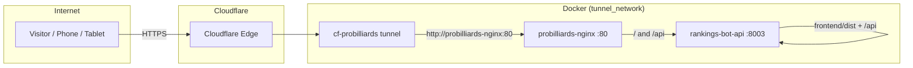
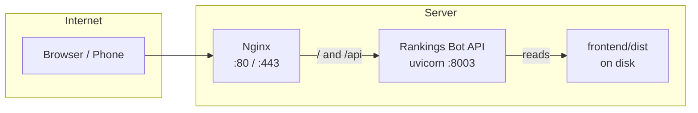
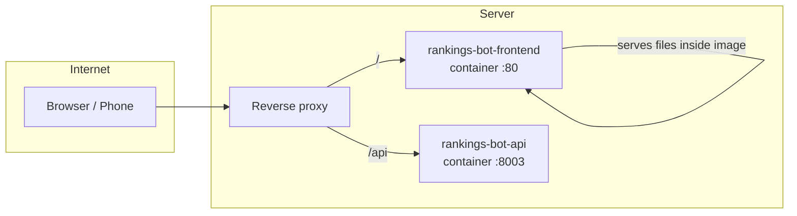

# Request flow and architecture — what talks to what

This doc is the **single place** that shows how traffic reaches the app and what you need to run when you change the website. No, it shouldn’t be difficult to implement changes — once you know your setup, it’s one or two commands.

**Standard flow (production):** **Cloudflare Tunnel → Nginx (container) → `rankings-bot-api` (Docker Compose, port 8003)**. `frontend/dist` is built with **`./scripts/build_frontend_with_docker.sh`** and mounted into the API container. See **docs/PRODUCTION_DEPLOYMENT.md**.

### How to see the diagrams

**Easiest (no install):** Open **`docs/diagrams/architecture.html`** in a browser. It shows all flow diagrams and a short diagnose checklist. No server or npm needed.

Other options:

1. **GitHub / GitLab** — Open this file in the repo on the web. GitHub and GitLab render Mermaid automatically.
2. **Cursor / VS Code** — Open this file and use **Markdown: Open Preview** (or `Ctrl+Shift+V` / `Cmd+Shift+V`). If diagrams don’t render, install an extension such as **“Markdown Preview Mermaid Support”** or **“Mermaid”**.
3. **Mermaid Live Editor** — Copy a ` ```mermaid ``` ` block from below, go to [mermaid.live](https://mermaid.live), paste, and view or export as PNG/SVG.

To export PNG/SVG from the repo: see **docs/diagrams/README.md** (optional `mermaid-cli`).

---

## Quick answer: “I changed the website, what do I run?”

| How you run the live site | What to run so the change shows |
|---------------------------|----------------------------------|
| **Production (Nginx → `rankings-bot-api` container)** | `./scripts/deploy_website.sh` or `./scripts/deploy_website.sh --reload-nginx` (Docker frontend build + `docker restart rankings-bot-api`) |
| **Full stack / image rebuild** | `./scripts/full_deploy.sh` |
| **Split frontend image** (rare) | Rebuild/restart **`rankings-bot-frontend`** only: [Deploy path: split frontend container](#deploy-path-split-frontend-container) |

**Development (no deploy):** `cd frontend && npm run dev` — edit code, save, browser updates. No rebuild needed.

---

## Diagrams: what talks to what

**Recommended standard:** One reverse proxy (Nginx), one backend (**`rankings-bot-api`** in Docker). See **docs/PRODUCTION_DEPLOYMENT.md**.

**Current flow (Feb 2026):** Tunnel → probilliards-nginx → rankings-bot-api (Docker). See **docs/diagrams/architecture.html** for full diagrams and “Why you don’t see updates.”

### Current: Cloudflare Tunnel → Nginx → API (Docker)



**After a website change (Option B):** `frontend/dist` is **mounted** from the host. Run **`./scripts/build_frontend_with_docker.sh`**, then `sudo docker restart rankings-bot-api` if needed. No API image rebuild. See **docs/DOCKER_BASE_AND_SMALL_EDITS.md**.

---

Below: **optional legacy** (uvicorn on the host) and an **alternate** split frontend container layout.

### Optional legacy: Nginx → host uvicorn (:8003)

**One proxy (Nginx), one backend (API on the host).** Nginx sends all traffic to the API. The API serves `frontend/dist` and `/api`. Prefer **`rankings-bot-api` in Compose** for production unless you intentionally use **HOST-API** nginx config.



**What to run after a website change (host uvicorn):**  
`./scripts/build_frontend_with_docker.sh`, then restart the **host** API process (e.g. systemd unit). **`restart_api.sh` is Docker-only** in this repo—it restarts **`rankings-bot-api`**, not host uvicorn. If you use Nginx on the host: `sudo systemctl reload nginx` when applicable.

---

### Alternate: split frontend container + API container

**Not the default for this repo.** A reverse proxy routes **/** to the frontend container and **/api** to the API container. The frontend container serves files baked into its image. The host’s `frontend/dist` is not used.



**What to run after a website change:**  
Rebuild the **frontend** image and restart the **frontend** container only (see [Deploy path: split frontend container](#deploy-path-split-frontend-container) below). Rebuilding the host’s `frontend/dist` is not enough — the container must be rebuilt and recreated.

---

## How to tell which setup you have

- **Cloudflare Tunnel** routes `www.probilliardssoftware.com` → `http://probilliards-nginx:80`. Nginx proxies to **`:8003`** — either **`rankings-bot-api`** (Compose) or host uvicorn, depending on your nginx config.
- **Nginx** config may use `rankings-bot-api:8003` (container DNS) or `127.0.0.1:8003` / `host.docker.internal:8003` (host listener).
- **Split frontend container:** optional; not the default **Option B** mount layout (see **docs/DOCKER_BASE_AND_SMALL_EDITS.md**).

---

## One recommended path so changes aren’t difficult

**Production (Compose API):** one command for website-only changes:

```bash
./scripts/deploy_website.sh --reload-nginx   # optional --reload-nginx
```

That runs **`build_frontend_with_docker.sh`** and **`docker restart rankings-bot-api`**. No host `npm`. For a **full** deploy: **`./scripts/full_deploy.sh`**.

If you use a **split frontend container** instead of mounted `dist/`, rebuild/restart that container when the website changes (section below).

---

## Deploy path: website only (`rankings-bot-api` + mounted `dist/`)

```bash
cd /path/to/rankings-bot
./scripts/deploy_website.sh
# If you use Nginx in front:
./scripts/deploy_website.sh --reload-nginx
```

Runs **`build_frontend_with_docker.sh`**, then **`docker restart rankings-bot-api`** (container **must** exist). For a **full** stack/image rebuild: **`./scripts/full_deploy.sh`**.

---

## Deploy path: split frontend container

When the live site is served by the **rankings-bot-frontend** container:

```bash
cd /path/to/Rankings-Bot
sudo docker-compose -f production/docker-compose.prod.yml build --no-cache rankings-bot-frontend
sudo docker stop rankings-bot-frontend 2>/dev/null; sudo docker rm rankings-bot-frontend 2>/dev/null
sudo docker-compose -f production/docker-compose.prod.yml up -d rankings-bot-frontend
```

If `up -d --force-recreate` works on your setup, you can use that instead of stop/rm. See **docs/DEPLOY_UPDATES.md** if you hit name conflicts or swarm issues.

---

## Optional: Use n8n to visualize or automate

- **Show what’s talking to what:** The diagrams above (and this doc) are the source of truth. You can recreate the same flow in n8n as a “documentation” workflow: one node per service (Browser, Nginx, API, frontend container, etc.) and connections showing who talks to whom. That gives you a visual in n8n you can share or edit.
- **Make changes easier:** Use n8n to run the deploy steps so you don’t have to remember them:
  - **Trigger:** Webhook (e.g. from GitHub after push) or Manual.
  - **Step:** Execute Command or SSH → run **`./scripts/deploy_website.sh`** (frontend + API restart) or **`./scripts/full_deploy.sh`** (full Docker deploy).

Example n8n flow (conceptual):

1. **Trigger:** Webhook or “Run workflow manually”.
2. **Execute Command / SSH:**  
   `cd /path/to/rankings-bot && ./scripts/deploy_website.sh`  
   (or `./scripts/full_deploy.sh` for a full image/stack deploy).

Then “implementing a change” = push code (or click “Execute” in n8n) and wait for the script to finish.

---

## Related docs

| Topic | Doc |
|-------|-----|
| Why updates didn’t show, hard refresh, which backend | **docs/DEPLOY_UPDATES.md** |
| Start/stop/restart API | **docs/START_STOP_RESTART.md** |
| What controls the site (short version) | **docs/WHAT_CONTROLS_THE_WEBSITE.md** |
| Full deploy from scratch | **docs/DEPLOY_WEBSITE.md** |
