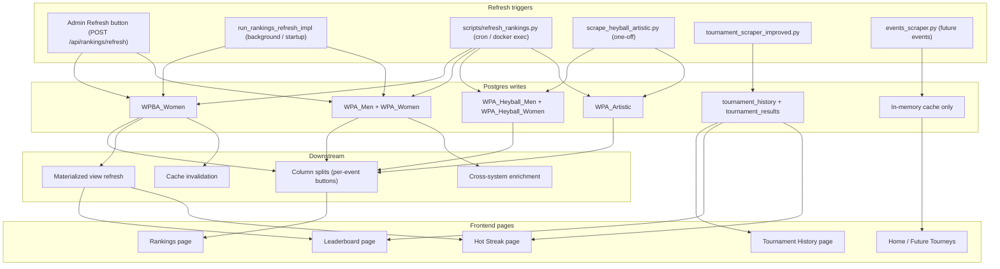

# Scraper to UI data map

For operators, developers, and AI assistants tracing "why is X stale on the website?"

This document maps every scraper and refresh entrypoint to the Postgres tables it writes, the downstream work it triggers (splits, materialized views, cache invalidation), and the frontend pages that read from those tables.

## Rankings snapshot model

All ranking points displayed in the UI come from the Postgres `rankings` table, keyed by `(ranking_system, snapshot_date)`. Each scraper or refresh writes rows with a specific `ranking_system` value. The frontend reads the latest `snapshot_date` for each system.

Primary ranking systems:

| System | Source | Description |
|--------|--------|-------------|
| `WPBA_Women` | WPBA PDF scraper | Overall WPBA standings |
| `WPBA_Women_*` | Column split from `WPBA_Women` | Per-tournament WPBA buttons |
| `WPA_Men` | WPA HTML scraper (table 0) | Overall WPA Men standings |
| `WPA_Men_*` | Column split from `WPA_Men` | Per-event WPA Men buttons |
| `WPA_Women` | WPA HTML scraper (table 1) | Overall WPA Women standings |
| `WPA_Women_*` | Column split from `WPA_Women` | Per-event WPA Women buttons |
| `WPA_Heyball_Men` | WPA HTML scraper (table 2) | Overall Heyball Men standings |
| `WPA_Heyball_Men_*` | Column split from `WPA_Heyball_Men` | Per-event Heyball Men buttons |
| `WPA_Heyball_Women` | WPA HTML scraper (table 3) | Overall Heyball Women standings |
| `WPA_Heyball_Women_*` | Column split from `WPA_Heyball_Women` | Per-event Heyball Women buttons |
| `WPA_Artistic` | PDF linked from the WPA Rankings page (`https://wpapool.com/rankings/`). Fallback file is the Feb 2026 upload marked Updated 2/16/25. | Overall Artistic standings |
| `WPA_Artistic_2022_WC` | Column split from that PDF | 2022 World Championship points. 2023 WC and 2024 WC points stay on the `WPA_Artistic` row `source_data` (`2023_wc_pts`, `2024_wc_pts`) because those system names are not in `rankings_ranking_system_check`. |
| `Competitors_Pool_9Ball`, `_Men_9Ball`, `_Women_9Ball` | Digital Pool GraphQL `vw_current_pro_rankings`, `vw_current_mens_pro_rankings`, `vw_current_womens_pro_rankings` | Overall composite and the two gender lists. Digital Pool does not publish an 8-ball or 10-ball pro ranking view. |
| `Competitors_Pool_8Ball`, `_10Ball` | Not scraped. The 8-ball and 10-ball helpers return an empty list so they cannot save the overall composite under those names. | Last distinct snapshots are 2026-03-08 (8-ball 70 rows, 10-ball 204 rows). The 2026-09-17 copies of the overall composite were removed. |
| `LOCAL` | Director tournament imports | Director-run tournament results |

For schema details see [RANKINGS_TABLE_DESIGN.md](RANKINGS_TABLE_DESIGN.md) and [RANKINGS_DATA_DOC_HOOKS.md](RANKINGS_DATA_DOC_HOOKS.md).

---

## Entrypoint matrix



### Full matrix

| Entrypoint | Ranking systems written | Follow-on DB work | Cache / MV | Frontend pages affected |
|------------|------------------------|-------------------|------------|------------------------|
| **Admin Refresh** (`POST /api/rankings/refresh`) | `WPBA_Women`, `WPA_Men`, `WPA_Women` | `split_wpba_women_to_column_buttons`, `split_wpa_men_to_column_buttons`, `split_wpa_women_to_column_buttons`, `fill_tournament_history_from_wpba_women_events`, `enrich_player_data` | `refresh_materialized_views`, invalidate `tournament-history` cache | Rankings (WPBA, WPA M/W tabs + per-event buttons), Leaderboard (WPBA/WPA M/W systems), Hot Streak (rankings-based association filters) |
| **`run_rankings_refresh_impl`** (background / startup) | `WPBA_Women`, `WPA_Men`, `WPA_Women` | Same splits as Admin Refresh, enrichment, WPBA tournament history fill | Same MV + cache | Same as Admin Refresh |
| **`scripts/refresh_rankings.py`** (cron / `docker compose exec`) | `WPBA_Women`, `WPA_Men`, `WPA_Women`, **`WPA_Heyball_Men`**, **`WPA_Heyball_Women`**, **`WPA_Artistic`**; Fargo table | All column splits including Heyball Men/Women and Artistic | `refresh_materialized_views`, invalidate `tournament-history` cache | Rankings (all tabs including Heyball M/W + Artistic), Leaderboard (all systems including Artistic in combined totals), Hot Streak |
| **`scrape_heyball_artistic.py`** (one-off) | `WPA_Heyball_Men`, `WPA_Heyball_Women`, `WPA_Artistic` | None (manual script; splits not wired) | None | Rankings (Heyball M/W, Artistic) after next page load |
| **`scrapers/wpba_scraper.py`** (standalone) | `WPBA_Women` | WPBA split + tournament history fill (if wired by caller) | Depends on caller | Rankings (WPBA), Leaderboard, Data Input |
| **Sync tournament history** (`POST /api/tournament-history/refresh-past`, super admin UI) | — (reads DB only) | `fill_tournament_history_from_rankings_snapshots`, `fill_tournament_history_from_wpba_women_events`, `refresh_materialized_views` | Invalidate `tournament-history` cache (frontend on completion) | Tournament History, Leaderboard past results, Hot Streak (placement/snapshot data derived from `rankings`) |
| **CP archive ingest** (`POST /api/tournament-history/fill-from-cp-archives`) | JSON files on disk | `fill_tournament_history_from_cp_archives` | MV + cache as implemented | Same TH / LB / HS when archive data present |
| **Tournament scraper** (`scrapers/tournament_scraper_improved.py`) | `tournament_history`, `tournament_results` | MV refresh if wired in calling job | Depends on caller | Tournament History page, Leaderboard "Past Tournament Results", Hot Streak (placement data) |
| **Future events** (`api/services/events_scraper.py`) | None (in-memory cache only) | None | 30-min TTL cache | Home page / Future Tourneys section |
| **Fargo CSV import** (`scripts/import_fargo_csv.py`) | `players` table (`fargo_score`, `fargo_robustness`) | None | None | Any page showing Fargo ratings (Rankings, Leaderboard, player profiles) |
| **Data Input / manual import** (`POST /api/rankings/import`) | Whichever `ranking_system` the import targets | Requires manual "confirm" + "Update rankings" | None until confirmed | Rankings page for the targeted system |
| **Tournament import + merge** (`POST /api/rankings/tournament-imports`) | `tournament_imports` then `rankings` after merge | Tournament-to-rankings merge recalculates points | None auto | Rankings for the merged system |

---

## Known gap: Admin Refresh does not update Heyball or Artistic

The Admin Refresh button and `run_rankings_refresh_impl` call `WPAScraper().scrape_all_html_divisions()`, which returns data for all four HTML tables (men, women, heyball_men, heyball_women). However, only `men` and `women` are persisted to the database. The `heyball_men`, `heyball_women`, and `artistic` keys from the bundle are silently discarded.

**Affected code paths:**
- `api/routes/rankings.py` lines ~1339-1392 (`trigger_rankings_refresh`): saves only `wpa_html_bundle["women"]` and `wpa_html_bundle["men"]`.
- `api/routes/rankings.py` lines ~106-178 (`run_rankings_refresh_impl`): same pattern.

**How to update Heyball and Artistic today:**

```bash
cd /home/ansible/rankings-bot/production
docker compose -f docker-compose.prod.yml exec -T rankings-bot-api \
  python3 scripts/refresh_rankings.py --wpa-only --force
```

This uses dedicated scrapers (`wpa_heyball_men_scraper`, `wpa_heyball_women_scraper`, `wpa_artistic_scraper`) and saves all systems plus their column splits.

See [RANKINGS_REFRESH_RUNBOOK.md](RANKINGS_REFRESH_RUNBOOK.md) for full details.

**Scheduler note:** `scripts/scraper_scheduler.py` has a cron entry for "Heyball/Artistic" at 20:00 that runs `python3 api/services/events_scraper.py heyball artistic`. That module is the **future calendar/events** scraper, not the rankings scraper. It does not update rankings data. This is a documentation/naming mismatch in the scheduler config.

---

## How to verify data freshness

Run inside the API container (`docker compose exec rankings-bot-api python3 -c "..."`) or via `psql`:

**Check latest snapshot dates for all systems:**

```sql
SELECT ranking_system, MAX(snapshot_date) AS latest, COUNT(*) AS rows
FROM rankings
GROUP BY ranking_system
ORDER BY ranking_system;
```

**Check Heyball and Artistic specifically:**

```sql
SELECT ranking_system, MAX(snapshot_date) AS latest, COUNT(*) AS rows
FROM rankings
WHERE ranking_system LIKE 'WPA_Heyball%'
   OR ranking_system LIKE 'WPA_Artistic%'
GROUP BY ranking_system
ORDER BY ranking_system;
```

**Check tournament history associations:**

```sql
SELECT COALESCE(NULLIF(TRIM(association), ''), '(empty)') AS assoc, COUNT(*) AS cnt
FROM tournament_history
WHERE tournament_id NOT LIKE 'rankings_snapshot%'
GROUP BY 1
ORDER BY 1;
```

If Heyball/Artistic `snapshot_date` is older than WPA Men/Women, Admin Refresh has run but `scripts/refresh_rankings.py` has not. Run the CLI script to bring them up to date.

---

## Related docs

- [HOW_DATA_IS_UPDATED.md](HOW_DATA_IS_UPDATED.md) — quick checklist for how data changes and UI refresh intervals.
- [RANKINGS_REFRESH_RUNBOOK.md](RANKINGS_REFRESH_RUNBOOK.md) — host vs container runtime, maintenance mode, canonical commands.
- [WPA_RANKINGS_DATA_FLOW.md](WPA_RANKINGS_DATA_FLOW.md) — WPA HTML ingestion, column splitting, per-event API menus.
- [WPBA_DATA_FLOW.md](WPBA_DATA_FLOW.md) — WPBA PDF pipeline and table design.
- [RANKINGS_TABLE_DESIGN.md](RANKINGS_TABLE_DESIGN.md) — schema, first-class columns, `source_data` JSONB.
- [SCHEDULED_REFRESH.md](SCHEDULED_REFRESH.md) — cron and APScheduler configuration.

---

## Known presentation gaps (2026-07 audit) — Inside Spin + Digital Pool

Substantial data is already scraped, archived, and persisted (see `insidesp_*` scrapers, `externalpool_*` scraper + harvester, `rankings.source_data`, `tournament_history_matches`, etc.) but is not yet given first-class UI treatment.

### Inside Spin (insidesp.in)
- Core value fields `insidesp_rating` (Display Rating) and `matches_rated` exist only as raw `source_data` keys on InsideSpin_* rows. No dedicated rating column, volume indicator, or methodology note in the Rankings table or player cards.
- Recent events catalog (Tier-1 listings + Tier-2 full participantRows with placement/points/slugs) is written for IS-only events but does not appear in any browsable "Inside Spin events" view or feed into Leaderboard/Tournament History beyond basic podium names.
- Player slugs from participant rows are captured but unused for cross-linking.

### Digital Pool / Competitors Pool
- Parallel ranks (`fargo_ranking`, `matchroom_ranking`, `wpa_*_ranking` and weighted variants, plus `digital_pool_*_ranking`) are stored per row in `source_data` for Competitors_Pool_* and DigitalPool_* systems. Currently only visible (if at all) as incidental extra columns; no comparison view or "also ranked in X" chips.
- Historical `pro_world_rankings` time series (`rank_date`, system code, rank) are harvested into snapshots but the UI only ever shows the latest snapshot per system. No date slider / history browser.
- Tournament enrichment (from `ExternalPoolTournamentHarvester`):
  - `tournament_players` fields beyond placement/points (seed, race_to, current_round, status, player_id, is_eliminated, points in the event) are fetched but only a minimal subset reaches `tournament_results`.
  - Full bracket + match data (stage/round/table/scheduled/scores/winner/fargo-at-match + many extra columns on `tournament_history_matches`) is written but there is no bracket viewer, schedule timeline, or "Stats/Performance" tab mirroring the source.
  - Player profile enrichment (city, gender, DP fargo_id + effective rating, join/updated dates) is fetched via `scrape_player_profile` but not exposed in modals or rankings.
- Tab-derived slices (schedule, live scores, stats, performance) are explicitly built in the harvester to match the DP SPA but have no UI surface.

**See also:** the dedicated section added to `ROADMAP.md` (2026-07) and `MULTI_SOURCE_DATA_INTEGRATION_PLAN.md` for ingestion details. All work below is presentation + small API deltas; the scraping/harvesting and storage is already done. Prioritize quick wins (rating columns, seeds/race_to, cross-rank chips, simple match drawer) per the roadmap entry.
